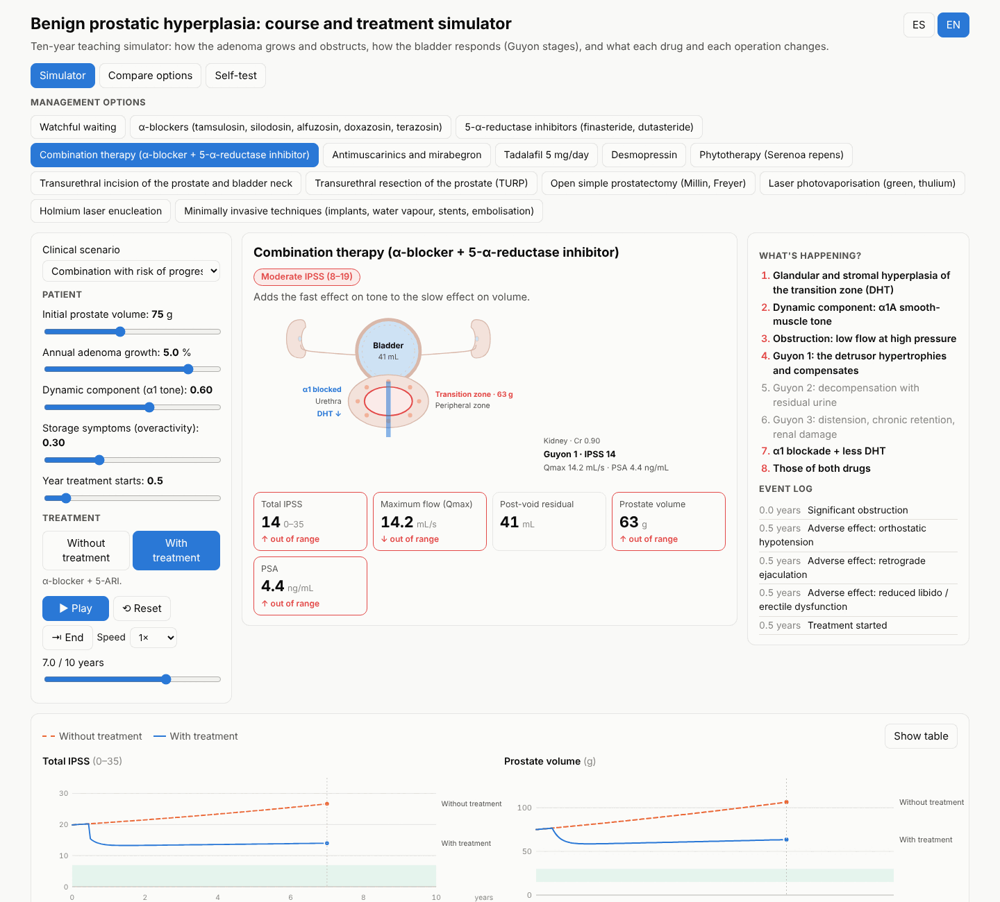

# Benign prostatic hyperplasia: a ten-year course and treatment simulator

**Hiperplasia benigna de próstata: evolución y tratamiento** — interactive teaching simulator (Spanish / English).

**Live demo:** https://ferasmed-dev.github.io/benign-prostatic-hyperplasia/ · English: https://ferasmed-dev.github.io/benign-prostatic-hyperplasia/?lang=en



A patient whose adenoma grows over ten years. Obstruction has a static part (adenoma volume) and a dynamic part (α1 tone); the bladder compensates and then decompensates through the Guyon stages to retention and renal damage. Every drug and operation is its own entry, acting on its own lever, and is compared with the untreated course. The diagram shows the bladder wall and residual, the transition zone growing inside the peripheral zone (hollow after surgery), the narrowing urethra, α1 receptors fading under α-blockade, and both kidneys.

## What it shows

| Option | Lever in the model | Indication |
|---|---|---|
| Watchful waiting | lifestyle: storage symptoms × 0.8, nocturia × 0.75 | mild symptoms |
| α-blockers | α1 tone × 0.35 within ~1 week; IPSS × 0.9 | moderate symptoms, any size |
| 5-α-reductase inhibitors | volume × 0.75 (τ 3 months), growth × 0.3, PSA halves | gland > 30–40 g |
| Combination | both | large gland at risk of progression |
| Antimuscarinic / mirabegron | storage symptoms × 0.5 (antimuscarinic: + residual) | predominant storage symptoms |
| Tadalafil 5 mg | IPSS × 0.8 | LUTS + erectile dysfunction |
| Desmopressin | nocturia × 0.45, Na − 6 mEq/L | nocturnal polyuria |
| Phytotherapy | IPSS × 0.9 | mild symptoms |
| Transurethral incision | static × 0.35, neck tone × 0.35 | < 30 g |
| TURP | 70 % of adenoma removed | 30–80 g |
| Open prostatectomy | 85 % removed | > 80 g |
| Photovaporisation | 55 % removed | < 80 g |
| Holmium enucleation | 85 % removed | any size |
| Minimally invasive | static × 0.45, tone × 0.7 | preserve ejaculation |

Every entity offers:

- a **schematic** that shows the mechanism live and highlights where the disorder acts;
- **sliders and choices** for the parameters that drive it;
- a **sin / con tratamiento** (without / with treatment) comparison drawn on the same chart (dashed = without, solid = with);
- a **"¿Qué está pasando?"** panel that lights up each step of the mechanism as it happens, plus an **event log**;
- gauges with reference ranges, a **data-table view** of every chart, a **compare** tab with all entities side by side and a **self-test** tab.

## Curriculum fit

For students and teachers at any Spanish medical faculty.

- **Module (Orden ECI/332/2008):** Módulo III, *Formación clínica humana* (with support from Módulo II for physiology and pathology).
- **Typical subjects:** Fisiopatología, Urología (Patología médico-quirúrgica), Farmacología, Geriatría, Medicina de familia.
- **MIR:** high-yield (IPSS cut-offs, α-blocker vs 5-ARI, surgery by gland size, Guyon stages, PSA under 5-ARI).

## For teachers

Every scenario has a deep link you can project or share. Add `&lang=en` for English.

| Preset | Scenario (EN) | Expected result | Link |
|---|---|---|---|
| `sintomas_leves` | Mild symptoms without complications | IPSS ~10–12, Qmax ~17, no obstruction stage; lifestyle trims nocturia | [ES](https://ferasmed-dev.github.io/benign-prostatic-hyperplasia/?preset=sintomas_leves) · [EN](https://ferasmed-dev.github.io/benign-prostatic-hyperplasia/?preset=sintomas_leves&lang=en) |
| `progresion_sin_tratar` | Large gland progressing untreated | 70 → 115 g; IPSS 19 → 29; Qmax 11 → 2; acute retention at year ~7 | [ES](https://ferasmed-dev.github.io/benign-prostatic-hyperplasia/?preset=progresion_sin_tratar) · [EN](https://ferasmed-dev.github.io/benign-prostatic-hyperplasia/?preset=progresion_sin_tratar&lang=en) |
| `alfa_prostata_pequena` | α-blocker in a small gland | IPSS 14 → 10 and Qmax 16 → 19 within weeks; PSA and volume unchanged | [ES](https://ferasmed-dev.github.io/benign-prostatic-hyperplasia/?preset=alfa_prostata_pequena) · [EN](https://ferasmed-dev.github.io/benign-prostatic-hyperplasia/?preset=alfa_prostata_pequena&lang=en) |
| `ari_prostata_grande` | 5-α-reductase inhibitor in a large gland | Volume 70 → ~55 g, PSA 4.9 → 3.9; no retention (untreated: retention at year ~9) | [ES](https://ferasmed-dev.github.io/benign-prostatic-hyperplasia/?preset=ari_prostata_grande) · [EN](https://ferasmed-dev.github.io/benign-prostatic-hyperplasia/?preset=ari_prostata_grande&lang=en) |
| `combinado_alto_riesgo` | Combination with risk of progression | Untreated: Guyon 3, retention, diverticula; treated: IPSS 20 → 14, Qmax 14 | [ES](https://ferasmed-dev.github.io/benign-prostatic-hyperplasia/?preset=combinado_alto_riesgo) · [EN](https://ferasmed-dev.github.io/benign-prostatic-hyperplasia/?preset=combinado_alto_riesgo&lang=en) |
| `predominio_llenado` | Predominant storage symptoms (mirabegron) | Storage subscore and nocturia fall; voiding unchanged | [ES](https://ferasmed-dev.github.io/benign-prostatic-hyperplasia/?preset=predominio_llenado) · [EN](https://ferasmed-dev.github.io/benign-prostatic-hyperplasia/?preset=predominio_llenado&lang=en) |
| `stui_y_disfuncion_erectil` | Urinary symptoms and erectile dysfunction | IPSS 14 → 12 | [ES](https://ferasmed-dev.github.io/benign-prostatic-hyperplasia/?preset=stui_y_disfuncion_erectil) · [EN](https://ferasmed-dev.github.io/benign-prostatic-hyperplasia/?preset=stui_y_disfuncion_erectil&lang=en) |
| `nocturia_predominante` | Predominant nocturia | Nocturia 2.5 → 1.1 per night; Na falls to ~134 (monitor) | [ES](https://ferasmed-dev.github.io/benign-prostatic-hyperplasia/?preset=nocturia_predominante) · [EN](https://ferasmed-dev.github.io/benign-prostatic-hyperplasia/?preset=nocturia_predominante&lang=en) |
| `prostata_pequena_tcp` | 25 g prostate | Incision at year 1: IPSS 13 → 9, Qmax 20, ejaculation preserved | [ES](https://ferasmed-dev.github.io/benign-prostatic-hyperplasia/?preset=prostata_pequena_tcp) · [EN](https://ferasmed-dev.github.io/benign-prostatic-hyperplasia/?preset=prostata_pequena_tcp&lang=en) |
| `rtup_60g` | TURP on a 60 g prostate | TURP at year 2: Qmax 12 → 21, IPSS 9, PSA 1.5 | [ES](https://ferasmed-dev.github.io/benign-prostatic-hyperplasia/?preset=rtup_60g) · [EN](https://ferasmed-dev.github.io/benign-prostatic-hyperplasia/?preset=rtup_60g&lang=en) |
| `adenomectomia_120g` | 120 g prostate with retention | Untreated: chronic retention, renal damage; surgery: Guyon 2 → 0, Qmax 21 | [ES](https://ferasmed-dev.github.io/benign-prostatic-hyperplasia/?preset=adenomectomia_120g) · [EN](https://ferasmed-dev.github.io/benign-prostatic-hyperplasia/?preset=adenomectomia_120g&lang=en) |
| `laser_anticoagulado` | Patient on anticoagulants (laser) | Photovaporisation: IPSS 16 → 9, no histology | [ES](https://ferasmed-dev.github.io/benign-prostatic-hyperplasia/?preset=laser_anticoagulado) · [EN](https://ferasmed-dev.github.io/benign-prostatic-hyperplasia/?preset=laser_anticoagulado&lang=en) |
| `holmio_100g` | Holmium enucleation of 100 g | Qmax 6 → 21, IPSS 9 | [ES](https://ferasmed-dev.github.io/benign-prostatic-hyperplasia/?preset=holmio_100g) · [EN](https://ferasmed-dev.github.io/benign-prostatic-hyperplasia/?preset=holmio_100g&lang=en) |
| `preservar_eyaculacion` | Wants to preserve ejaculation | IPSS 14 → 12, Qmax 15 → 18, ejaculation preserved | [ES](https://ferasmed-dev.github.io/benign-prostatic-hyperplasia/?preset=preservar_eyaculacion) · [EN](https://ferasmed-dev.github.io/benign-prostatic-hyperplasia/?preset=preservar_eyaculacion&lang=en) |

You can also open a single entity with `?entity=<key>` (keys are listed in `src/model.js`).

## Model

- Adenoma grows at the chosen %/year; PSA ≈ 0.07 ng/mL per gram (Model).
- Obstruction index `OB = 0.012·max(0, V − 25)·staticFactor + 0.45·tone` (Model).
- `Qmax = 22 − 14·OB − 3·D` (2–25 mL/s), where D (0–1) is detrusor decompensation, which accumulates at `0.12·(OB − 0.6)` per year above OB 0.6 and recovers after relief.
- Residual `= 15 + 80·max(0, OB − 0.3) + 350·D` mL; Guyon 0 (OB < 0.4), 1 (residual < 100), 2 (100–300), 3 (> 300, chronic retention); creatinine rises above 300 mL residual.
- IPSS = voiding subscore `3 + 11·OB + 4·D` (≤ 20) + storage subscore `2 + 9·storage + 3·OB` (≤ 15), so a small irritable gland can score higher than a large quiet one.

**Model** tag: constants marked "Model" in `src/model.js` are teaching assumptions tuned so each preset reproduces the textbook course; they are not fitted to patient data.

### Parameters

| Parameter | Range (default) | Basis |
|---|---|---|
| Initial volume | 20–150 g (50) | — |
| Adenoma growth | 0–6 %/year (3) | Model |
| Dynamic component | 0–1 (0.5) | Model |
| Storage symptoms | 0–1 (0.3) | Model |
| Treatment start | year 0–5 (1) | — |
| IPSS classes | 0–7 / 8–19 / 20–35 | standard |
| Surgery by size | < 30 / 30–80 / > 80 g | EAU |

### Known simplifications

- One symptom score drives both subscores; individual IPSS items are not modelled.
- Adverse effects are events, not probabilities; surgical complications are not modelled quantitatively.
- PSA is benign PSA only; cancer is out of scope.

### Content beyond the core notes

- BPH is placed in the **transition zone** (standard); some notes also call it the central zone.
- DHT increases growth factors (EGF) and lowers the inhibitory **TGF-β** (written "TNF-β" in some notes).
- Indications for watchful waiting vs drugs follow the EAU guideline: mild symptoms → watchful waiting; moderate–severe → drugs.
- The TURP range (30–80 mL) and holmium enucleation for any size follow the EAU guideline.

## Layout

```
index.html
src/model.js       pure model: entities, gauges, presets, simulate()
src/i18n.js        ES + EN strings (events are factories, so a language switch re-renders them)
src/ui.js          DOM, animation loop, explanations; exposes window.__sim for automated checks
src/schematic.js   SVG schematic of the mechanism, redrawn every frame
src/charts.js      dependency-free SVG line charts with hover tooltips and table view
src/styles.css     light/dark via prefers-color-scheme, responsive
tests/model.test.js
curriculum.json    topic metadata
```

## Run locally

```bash
python3 -m http.server 8000
# open http://localhost:8000/
```

No build step, no dependencies.

## Tests

```bash
npm test        # node --test (Node 18+)
```

The tests cover well-formed output for every entity at default and extreme parameters (finite, non-negative, valid steps), purity, i18n completeness in both languages, every preset, and the key mechanism of each entity (direction of each effect and the treatment comparison). GitHub Actions runs them on every push.

## Deploy (GitHub Pages)

Settings → Pages → *Deploy from a branch* → `main` / `(root)`. The site is served at https://ferasmed-dev.github.io/benign-prostatic-hyperplasia/.

## References

- Gravas S, et al. EAU Guidelines on Management of Non-Neurogenic Male LUTS, incl. BPO. European Association of Urology, 2024.
- McConnell JD, et al. The long-term effect of doxazosin, finasteride, and combination therapy on BPH progression (MTOPS). *N Engl J Med* 2003;349:2387–98.
- Roehrborn CG, et al. CombAT study. *Eur Urol* 2010;57:123–31.
- Lepor H. Pathophysiology, epidemiology and natural history of BPH. *Rev Urol* 2004;6(Suppl 9):S3–10.

---

Herramienta docente · no apta para uso clínico — Teaching tool · not for clinical use. MIT licence © 2026 Feras Elhissi.
